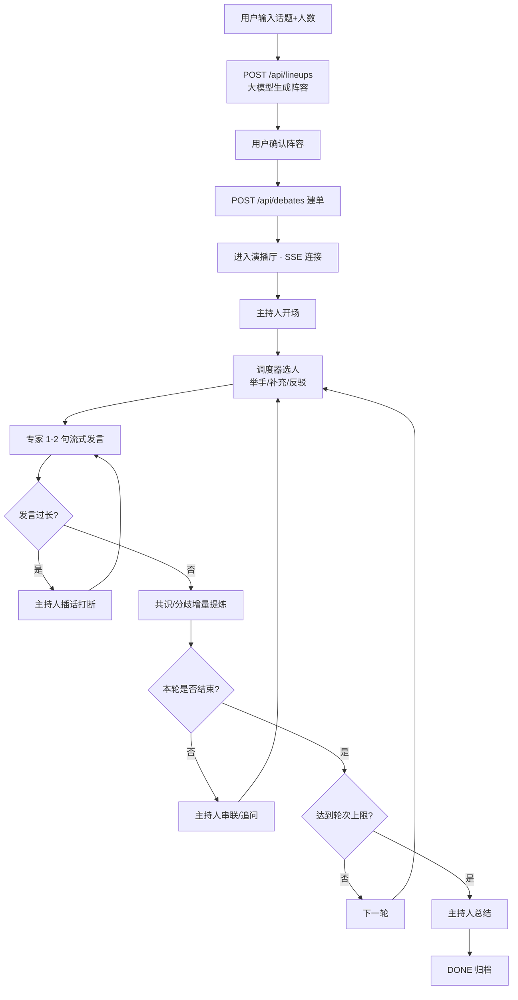
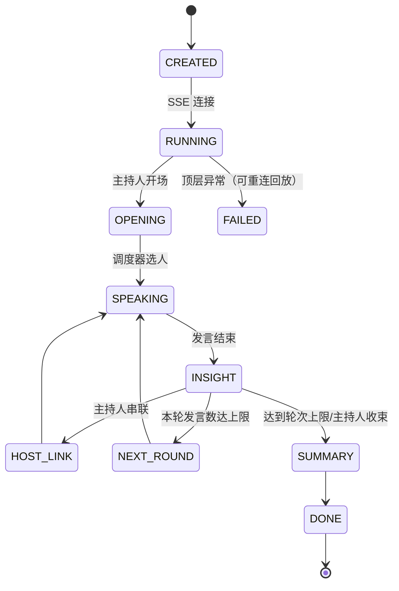

# PRD：AI Panel Studio（AI 圆桌演播厅 MVP）

## 1. 产品定位

输入任意话题 + 专家人数（默认 4），系统调用大模型**动态生成**主持人 + 专家阵容（姓名 / 职业 / Title / 立场 / 专属颜色），用户确认后进入演播厅，观看一场实时推进的多轮圆桌讨论。

## 2. 用户与痛点

| 用户 | 诉求 | 对应功能 |
|---|---|---|
| 知识工作者 / 研究人员 | 几分钟内获得多视角深度争辩 | 多专家异质立场 + 主持人追问 |
| 产品 / 决策人员 | 预演各方立场、发现盲点 | 实时共识与分歧区 |
| 教育 / 内容创作者 | 可录制、可回放的结构化内容 | 历史归档 + Transcript + 总结 |

痛点 → 解法：
1. 视角单一 → 阵容生成阶段强制「立场互相对立」；
2. 异步割裂 → 单一 Orchestrator 持有全局 transcript，专家共享上下文；
3. 过程不可见 → SSE 逐字流式 + 专家状态小窗 + 实时共识/分歧；
4. 议题管理混乱 → 每场讨论独立实体与事件流，按 debate_id 隔离。

## 3. 功能需求（对照作业条目）

| 编号 | 需求 | 实现位置 |
|---|---|---|
| F1 | 首页列表 + 加入观察 | `frontend/js/app.js` renderHome |
| F2 | LLM 动态生成阵容 + 用户确认 | `POST /api/lineups` + 创建页阵容确认 |
| F3 | 自主发言调度（举手/抢答/补充/反驳） | `app/agents/director.py` |
| F4 | 每次发言 1-2 句 | `prompts/guest.v4.json` + 120 字打断阈值 |
| F5 | 专家状态小窗（待机/准备发言/发言中 + 公开思考摘要） | SSE `agent_status` 事件 |
| F6 | 实时共识与分歧 | `app/agents/insight.py` + SSE `insight` |
| F7 | Transcript（姓名 + 职业/Title + 色块，不含内部事件） | 右侧 Transcript 面板 |
| F8 | 主持人自然语言总结，页面不出现 JSON | `_emit_host` 只推 content |
| F9 | Key 仅后端环境变量 | `app/config.py` |
| F10 | 多讨论并行隔离 | 按 debate_id 隔离 + E2E 验证 |
| F11 | SSE 实时推流 | `GET /api/debates/{id}/stream` |
| F12 | 中文 UI + 区域独立滚动 + 响应式 | `frontend/css/style.css` |

## 4. 核心流程

## 5. 状态机

## 6. 非功能与约束

- 前后端分离；SQLite；Key 仅后端 env；
- 禁止单一 Prompt 一键生成（Prompt 分文件、分版本、进 Git）；
- 任何单点失败不中断直播（降级链见 README 兜底表）；
- 交付期限 72 小时，过程可溯优先于"完美成品"。
