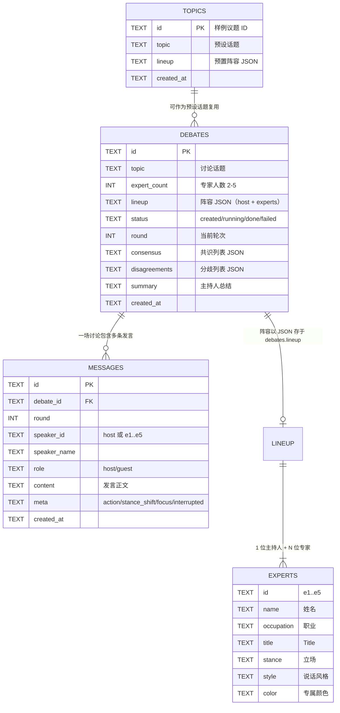

# ER 图与数据建模

> 数据库：SQLite；初始化脚本：`scripts/init_db.sql`（含 ≥5 条样例数据）。

## 1. 实体关系

## 2. 关键建模决策

| 决策 | 理由 |
|---|---|
| 阵容以 JSON 存于 `debates.lineup` | 阵容由大模型动态生成、字段可能演进；MVP 阶段避免为动态实体建多张表导致迁移负担。专家 id 稳定（`e1..e5`），发言与状态小窗都靠它关联。 |
| `messages.meta` 存动作与立场漂移 | action（举手/补充/反驳）、stance_shift、interrupted 属于"发言的属性"而非主字段，JSON 扩展不影响 schema。 |
| 共识/分歧直接落在 `debates` 行 | 每场讨论一份、随发言增量覆盖写，天然隔离，读取成本低。 |
| `topics` 独立表 | 承载 ≥5 条高质量样例数据（预设话题 + 阵容），与运行态数据解耦。 |
| `messages` 以 `rowid` 排序 | SQLite 插入顺序即发言顺序，避免时间戳精度问题。 |

## 3. 隔离性说明

所有运行态读写都以 `debate_id` 为键：`messages.debate_id` 索引、共识/分歧随 debate 行存储、SSE 事件流按 debate 独立生成。因此多场讨论可并行推进互不干扰（E2E `test_03_two_debates_isolated` 验证）。
